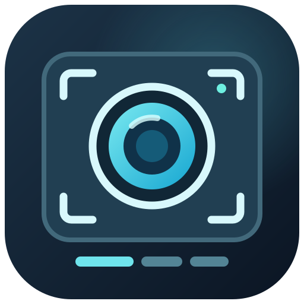
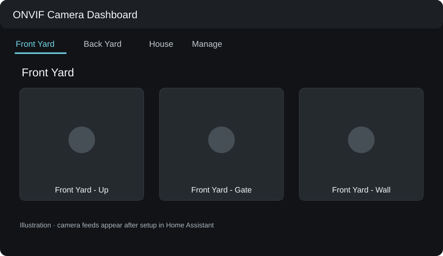

# ONVIF Camera Dashboard



[](https://my.home-assistant.io/redirect/marketplace_repository/?owner=nemke&repository=onvif-camera-dashboard&category=plugin)

A Home Assistant dashboard plugin that adds every **configured, enabled ONVIF camera entity** to a camera dashboard. It organizes camera tabs by Home Assistant area or floor, or by categories you create. New camera entities appear automatically after ONVIF setup succeeds.



## Features

- Native Sections views and `picture-entity` camera cards.
- Area, floor, or custom category tabs with editable names and a searchable Home Assistant icon picker.
- Camera order, display name, image entity, and visibility controls.
- A small admin-only edit icon on each feed for changing that camera directly; only one camera editor opens at a time.
- An admin-only **Hidden** tab for restoring hidden cameras without showing them among live feeds.
- An **Unassigned** tab for cameras without a category.
- An administrator **Settings** tab for managing tabs, with an optional importer for an existing dashboard.
- Multiple ONVIF profiles stay separate. A card may use a different `camera_image` entity, as in the supplied Hallway example.

The plugin reads camera entities that Home Assistant's ONVIF integration has already created. ONVIF network discovery, camera credentials, and stream troubleshooting remain in Home Assistant's ONVIF setup.

## Install from Marketplace

Requires Home Assistant **2026.11.0 or newer**.

1. Select the Marketplace badge above to open this repository in Home Assistant. While the catalog submission is under review, the link offers to add it as a custom repository. You can also go to **Settings → Marketplace → Add from link** and enter `nemke/onvif-camera-dashboard`.
2. Open **ONVIF Camera Dashboard** in Marketplace and select **Install**.
3. Reload Home Assistant in your browser. If an older version still appears, do a hard refresh.
4. Under **Settings → Dashboards**, add **ONVIF Camera Dashboard** from Community dashboards.

If the Community dashboards picker is unavailable, create a new storage-mode dashboard and use this raw configuration:

```yaml
strategy:
  type: custom:onvif-camera-dashboard
  group_by: area
```

Open its **Settings** tab to set up the tabs. Use the pencil icon on a feed to change that camera's name, tab, image entity, order, view, or visibility. Hidden cameras appear only in the administrator **Hidden** tab, where you can edit them to show them again. To migrate a dashboard like the one in the project brief, expand **Import tabs from an existing dashboard**, choose the source, select **Import into draft**, review the tabs, then select **Save dashboard**. Import reads the source dashboard and updates only the new dashboard when saved.

## Manual installation

If you cannot use Marketplace, build and install the plugin directly:

1. Run `npm run build` in this repository. No dependencies need installing.
2. Copy **both** files from `dist/` into `/config/www/community/onvif-camera-dashboard/` on Home Assistant.
3. Add `/local/community/onvif-camera-dashboard/onvif-camera-dashboard.js?v=0.1.6` as a JavaScript module under **Settings → Dashboards → Resources**.
4. Reload Home Assistant in the browser. Change the URL version when installing a newer build.

Marketplace installs register the resource automatically; keep only one resource entry for this plugin.

## Development

```sh
npm test
npm run build
```

The strategy and management UI are in `src/onvif-camera-dashboard.js`. Camera filtering, grouping, generation, and import are in `src/core.js`.

## Notes

- The Settings tab is generated only for Home Assistant administrators. Other users can view the camera tabs.
- Camera assignments are stored in this dashboard's strategy configuration. The management UI saves through Home Assistant's dashboard WebSocket API.
- Enabled ONVIF camera entities are included even if their current state is `unavailable`; disabled entities have no usable card until enabled in Home Assistant.
- The plugin does not change ONVIF integrations, camera credentials, existing dashboards, or Home Assistant area and floor assignments.
